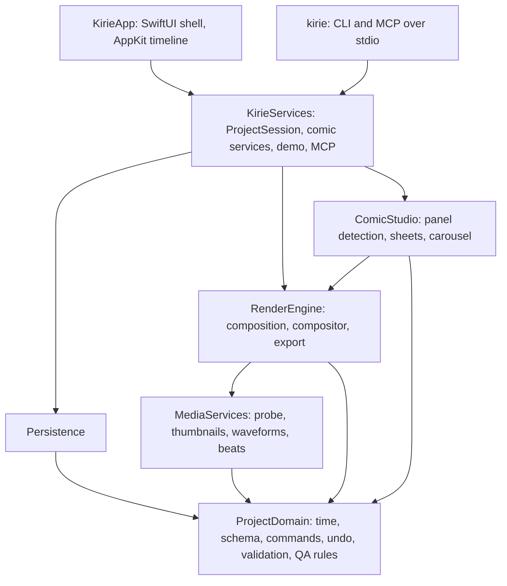
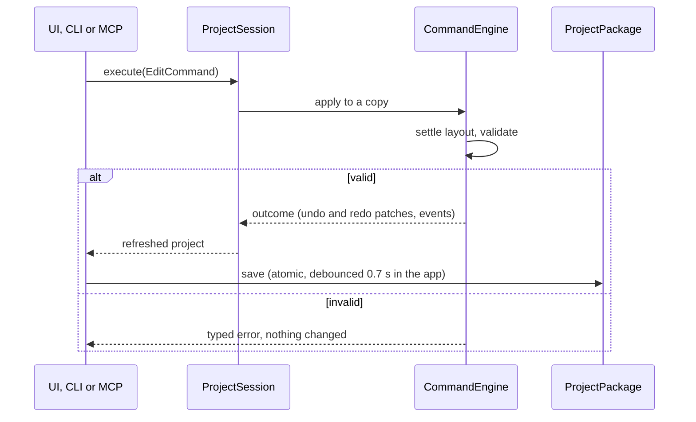
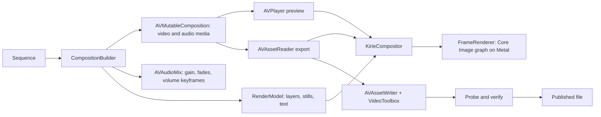

# Architecture

## Modules

`ProjectDomain` depends only on Foundation and CryptoKit. Nothing in it touches files, AVFoundation or the UI, which is why most behaviour can be unit tested in milliseconds.

## How an edit travels

There is no other way to change a project. The app's `EditorModel.perform`, `kirie apply` and the MCP `apply_commands` tool all end at `CommandEngine.execute`.

## Timeline model

Project → sequences → tracks → clips. Track kinds: `main` (magnetic, one per sequence), `overlay`, `audio`, `text`, `caption`. Tracks are stored bottom to top in render order.

- The main track is always gapless. A clip's `transitionIn` makes it overlap the previous clip by the transition's length (at most half the shorter neighbour).
- Free tracks never contain overlapping clips; a command that would create one is rejected.
- Clips linked by Detach Audio move together when the main track ripples.
- Comic Studio builders (strip reel, montage, lyric edit) produce ordinary sequences. Their output can be edited like any other timeline.

## Render pipeline

For each frame the compositor walks the tracks bottom to top. On the main track, two clips overlapping means a transition: both are rendered to full-canvas layers and combined by a pure function of (outgoing, incoming, progress). Text is rasterised with Core Text into cached bitmaps and only moved, scaled and faded on the GPU. Lyric lettering is laid out word by word so each word can arrive on its own time.

## Comic Studio

- **Panel detection** (`PanelDetector`): finds the page colour from the image border, builds an integral image of "not page colour", then recursively splits on clear runs of page colour (rows first, then columns). It makes no assumption about a grid.
- **Framing** (`SubjectFinder`, `FramingPlanner`): content bounds are everything in a panel that is not its background colour. The planner fits the panel to the canvas, reduces the push-in, or falls back from fill to fit, so the content plus a margin is never cropped. The verdict is shown as PASS or FAIL per panel.
- **QA gate** (`QAGate`): approval records the SHA-256 of the image file and a hash of the review (panels, notes, answers). The export lock is derived, never stored: it compares those hashes with the file on disk and the review as they are now.

## Concurrency

- UI state lives on the main actor (`EditorModel`, `AppModel`, `PlayerController`).
- Import probing, thumbnails, waveforms, beat analysis, composition building and export run off the main thread and report back.
- The compositor renders on its own serial queue. Export pumps video and audio on separate queues and is cancellable.

## Security boundaries

- Project files, subtitle files and media are treated as untrusted: sizes and dimensions are bounded, parsers are tolerant and never trap, and a relative media path cannot resolve outside the project package.
- The MCP server exposes a fixed list of tools. Edits are decoded into `EditCommand` values; destructive commands and exports need an explicit confirmation flag; export output is confined to the project's `Exports` folder.
- There is no networking code. A test fails the build if any appears in `Sources`.
