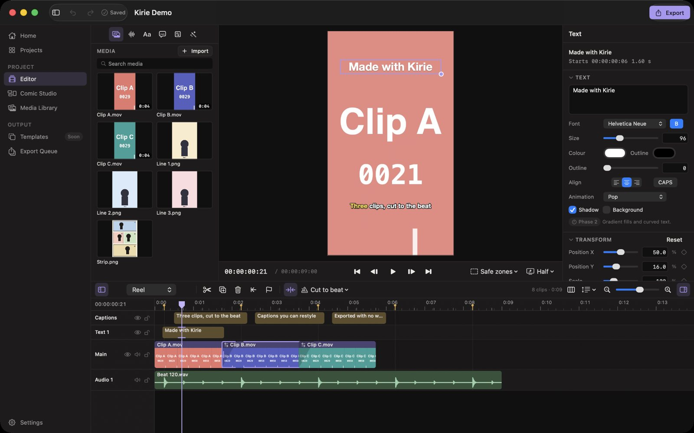
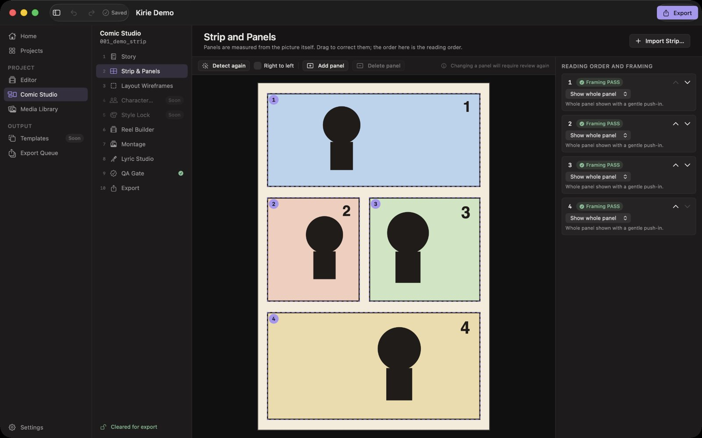
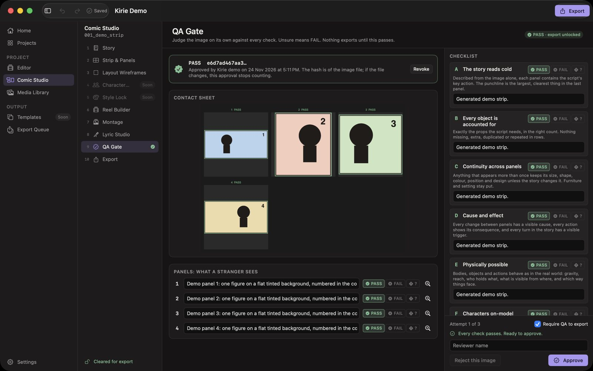
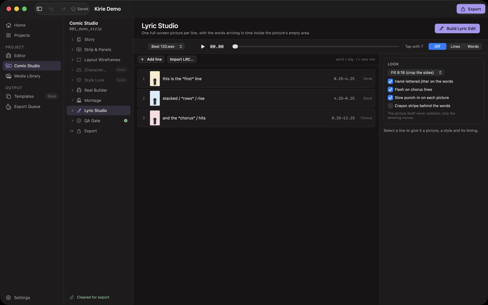
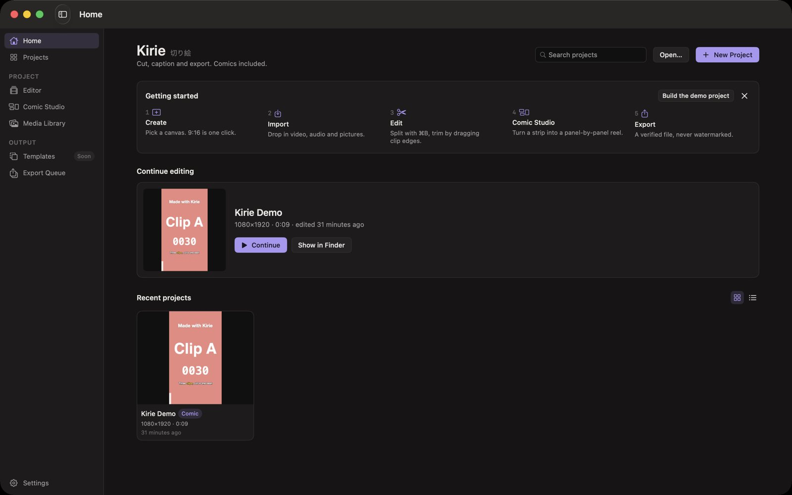

# Kirie

**Kirie** (切り絵, "cut picture") is a native macOS video editor for short-form video, with a Comic Studio for turning comic strips into reels, lyric edits and photo montages.

It is local-first: no account, no network connections, no watermark. Everything in the editor, the command-line tool and the MCP server goes through the same typed, undoable edit commands.



| Comic Studio: panels | QA gate |
|---|---|
|  |  |

| Lyric Studio | Home |
|---|---|
|  |  |

## Status

This repository holds **Phase 1** (the core editor and the Comic Studio basics) plus parts of Phase 2 that the Comic Studio workflow needs (the QA gate, the CLI and an MCP server). The phases after that are designed but not built.

[Docs/FeatureMatrix.md](Docs/FeatureMatrix.md) lists every feature with an honest status: implemented, partial, deferred or blocked. Nothing in the app is a mock: a control either works or is labelled as planned.

What works today:

- **Editing:** magnetic main track with overlay, audio, text and caption tracks; split, trim, move, duplicate, ripple delete; constant speed; keyframes for position, scale, rotation, opacity and volume; 15 transitions; colour controls, looks and effects; chroma key, masks and blend modes; snapping, markers, undo and redo.
- **Text and captions:** titles with animation; captions from SRT, VTT and LRC; karaoke, pop, bounce and typewriter styles; on-device transcription through Apple's Speech framework.
- **Audio:** waveforms, gain, fades, volume keyframes, beat detection with bar starts, and cut-to-beat.
- **Comic Studio:** panel detection from the image itself, subject-safe framing, panel-by-panel reels, montages on a time grid, lyric edits with word timing and tap-to-time, a QA gate with an export lock tied to the image's SHA-256, carousel slides and layout wireframes.
- **Export:** H.264, HEVC and ProRes 422 through VideoToolbox, up to 4K, with every exported file re-opened and verified before it is published. Commercial music that you mark as unlicensed is never written into a file.
- **Reliability:** atomic saves after every change, snapshots, recovery from a damaged project file, portable projects.
- **Automation:** `kirie` CLI with JSON output, and an MCP server scoped to one project.

## Requirements

- macOS 14 or later on Apple Silicon.
- To build: the Xcode Command Line Tools (Swift 6) are enough. Full Xcode is optional.

There are no third-party dependencies.

## Build, test and run

```bash
Scripts/test.sh
```

```bash
Scripts/build-app.sh
```

```bash
open dist/Kirie.app
```

`Scripts/test.sh` runs the suite with Swift Testing and also works when only the Command Line Tools are installed. `Scripts/build-app.sh` produces `dist/Kirie.app`, ad-hoc signed, with the CLI inside it at `Contents/Helpers/kirie`.

To try it without your own media, choose **Build the demo project** on the Home screen, or:

```bash
swift run kirie demo ~/Movies/Kirie
```

The demo is generated on your Mac (three clips, a click track, a four-panel strip and three stills), so it carries no licensing strings.

## Command line and MCP

```bash
swift run kirie help
```

```bash
swift run kirie export "~/Movies/Kirie/Kirie Demo.kirie" --sequence "Strip reel"
```

```bash
swift run kirie mcp "~/Movies/Kirie/Kirie Demo.kirie"
```

See [Docs/UserGuide/CLI.md](Docs/UserGuide/CLI.md).

## Documentation

- [Getting started](Docs/UserGuide/GettingStarted.md)
- [Feature matrix](Docs/FeatureMatrix.md)
- [Architecture](Docs/Architecture/Architecture.md) and [ADR 0001: foundations](Docs/Architecture/ADR-0001-foundations.md)
- [Project file format](Docs/ProjectFormat/ProjectFormat.md)
- [Building, signing and notarising](Docs/UserGuide/Building.md)
- [Privacy, security and media rights](Docs/Privacy.md)
- [Engineering handoff: test results, measurements, risks and next milestones](Docs/Handoff.md)

## Licence

No licence has been chosen yet, so all rights are reserved by the author. Kirie uses only Apple system frameworks; there is no bundled third-party code and no FFmpeg.
